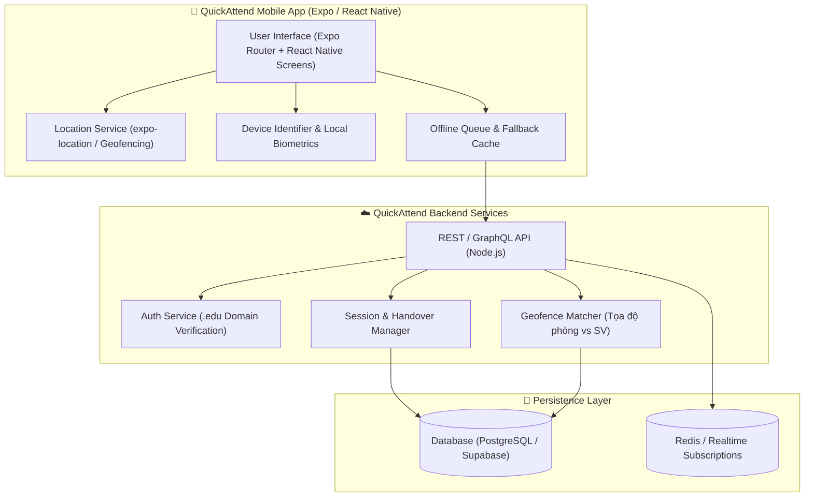

# QuickAttend - One-Tap Mobile Attendance & Session Delegation

[](https://opensource.org/licenses/MIT)
[](https://hcmut.edu.vn)
[](https://cse.hcmut.edu.vn)
[](https://reactnative.dev)
[](https://expo.dev)
[](https://www.typescriptlang.org)

> **QuickAttend** là giải pháp điểm danh di động một chạm thế hệ mới, tối ưu hóa quy trình điểm danh học đường bằng công nghệ định vị Geofencing GPS kết hợp khóa phần cứng thiết bị (Hardware Binding) và cơ chế bàn giao quyền điểm danh tạm thời (Temporary Teacher Handover) độc quyền.

---

## 📌 Mục lục

- [1. Giới thiệu dự án](#1-giới-thiệu-dự-án)
- [2. Thành viên nhóm](#2-thành-viên-nhóm)
- [3. Vấn đề & Giải pháp](#3-vấn-đề--giải-pháp)
- [4. Điểm vượt trội của QuickAttend](#4-điểm-vượt-trội-của-quickattend)
- [5. Phạm vi MVP & Danh sách User Stories](#5-phạm-vi-mvp--danh-sách-user-stories)
- [6. Kiến trúc hệ thống & Công nghệ](#6-kiến-trúc-hệ-thống--công-nghệ)
- [7. Cấu trúc thư mục dự án](#7-cấu-trúc-thư-mục-dự-án)
- [8. Hướng dẫn cài đặt & Khởi chạy](#8-hướng-dẫn-cài-đặt--khởi-chạy)
- [9. Lộ trình phát triển (Roadmap)](#9-lộ-trình-phát-triển-roadmap)
- [10. Quy chuẩn đóng góp (Git Flow & Conventions)](#10-quy-chuẩn-đóng-góp-git-flow--conventions)
- [11. Giấy phép](#11-giấy-phép)

---

## 1. Giới thiệu dự án

- **Tên dự án:** QuickAttend (Hệ thống điểm danh di động siêu tốc và chuyển giao phiên)
- **Môn học:** Phát triển ứng dụng Mobile App (CO3043) - Lớp L01
- **Khoa:** Khoa Khoa học và Kỹ thuật Máy tính - Trường Đại học Bách Khoa, ĐHQG-HCM
- **Giảng viên hướng dẫn:** ThS. Hoàng Lê Hải Thanh
- **GitHub Repository:** [QuickAttend-Team/QuickAttend](https://github.com/QuickAttend-Team/QuickAttend)
- **GitHub Wiki:** [QuickAttend Documentation Wiki](https://github.com/QuickAttend-Team/QuickAttend/wiki)

---

## 2. Thành viên nhóm

| STT | Họ và tên | MSSV | Vai trò trong dự án | GitHub Profile |
|:---:|:---|:---:|:---|:---|
| 1 | **Nguyễn Hồng Thiện Nhân** | 2410670 | **Git Manager / Backend API & Database Lead** | [@thiennhan](https://github.com) |
| 2 | **Lâm Chí Nguyên** | 2412332 | **Frontend Mobile Lead / Architecture** | [@chinguyen](https://github.com) |
| 3 | **Ngô Võ Gia Minh** | 2412069 | **Mobile UI/UX Design & Frontend Feature Dev** | [@MinhGiaVoNgo](https://github.com/MinhGiaVoNgo) |
| 4 | **Nguyễn Huỳnh Tấn Phát** | 2412585 | **QA / Testing, Geofencing & Hardware Auth** | [@tanphat](https://github.com) |

---

## 3. Vấn đề & Giải pháp

### ⚠️ Bối cảnh & Nút thắt thực tế
1. **Thao tác thiết lập cồng kềnh:** Giảng viên tốn nhiều thời gian cấu hình ca học, phòng học và cơ chế điểm danh mỗi đầu buổi.
2. **Bất tiện khi có biến động:** Khi đổi phòng học đột xuất hoặc có giảng viên dạy thay / trợ giảng, việc phân quyền quản trị trên hệ thống LMS rất rủi ro, rườm rà và chậm trễ.
3. **Gian lận điểm danh hộ:** Các giải pháp dùng QR code tĩnh, Google Form hay điểm danh giấy dễ bị chụp ảnh gửi ra ngoài hoặc ký hộ.

### 💡 Giải pháp QuickAttend
- **One-tap Setup với Template thông minh:** Đóng gói thông tin phòng học, tọa độ GPS, bán kính và danh sách sinh viên. Giảng viên chỉ cần **1 chạm** để mở phiên.
- **Bàn giao phiên tạm thời (Temporary Teacher Handover):** Bàn giao quyền điều hành phiên điểm danh cho đồng nghiệp chỉ bằng email/mã an toàn trong ca học mà không cần can thiệp quyền LMS.
- **Xác thực vị trí 1 chạm (One-tap Geofencing):** Sinh viên chỉ cần bấm "ĐIỂM DANH NGAY" khi có mặt tại phòng học, hệ thống tự động đối soát tọa độ GPS và khóa mã định danh phần cứng thiết bị (Hardware UUID).

---

## 4. Điểm vượt trội của QuickAttend

| Tiêu chí | Điểm danh truyền thống | Google Form / QR tĩnh | Phân hệ LMS (Moodle/Canvas) | **QuickAttend** |
|:---|:---:|:---:|:---:|:---:|
| **Thời gian tạo phiên** | Tốn 3 - 5 phút | Tốn 2 - 3 phút | Tốn 1 - 2 phút (nhiều click) | **< 5 giây (1 chạm)** |
| **Thời gian SV thao tác** | Xếp hàng đọc tên | 15 - 30 giây (điền form) | 10 - 20 giây | **< 3 giây (1 chạm)** |
| **Chống điểm danh hộ** | Kém (ký hộ) | Rất kém (gửi link từ xa) | Trung bình | **Rất cao (GPS + Device UUID)** |
| **Chuyển giao dạy thay** | Chuyền giấy thủ công | Chia sẻ link form phức tạp | Rất chậm (cần admin cấp quyền) | **Tức thì (1-chạm qua Email/Code)** |
| **Bảo vệ quyền riêng tư** | N/A | Thu thập email | Lưu log truy cập | **Privacy-First (chỉ lưu Boolean Geofence)** |

---

## 5. Phạm vi MVP & Danh sách User Stories

Theo kết quả đánh giá bằng chứng từ Milestone 1, MVP QuickAttend gồm 8 User Stories cốt lõi:

### Nhóm A: Authentication & Onboarding
- **US01 - Đăng ký tài khoản Giảng viên bằng Email trường:** Đăng ký bằng email `.edu` / `.edu.vn`, hệ thống tự cấp quyền Host.
- **US02 - Đăng ký & Khóa thiết bị Sinh viên (Hardware Binding):** Tự động liên kết tài khoản sinh viên với Device UUID trong lần đầu để ngăn mượn máy điểm danh hộ.

### Nhóm B: Host Features (Dành cho Giảng viên)
- **US03 - Tạo & Lưu mẫu điểm danh ca học (Attendance Templates):** Thiết lập tên môn, phòng học, tọa độ tâm và bán kính GPS (20m, 50m).
- **US04 - Khởi chạy phiên điểm danh 1 chạm (One-Tap Attendance Launch):** Mở phiên điểm danh tức thì từ mẫu đã lưu kèm đồng hồ đếm ngược.
- **US05 - Bàn giao quyền quản lý tạm thời (Temporary Delegation):** Chia sẻ quyền quản lý phiên cho giảng viên dạy thay theo ca qua email.
- **US06 - Theo dõi tiến độ điểm danh thời gian thực (Active Session Monitoring):** Bảng hiển thị sĩ số, danh sách sinh viên hợp lệ / ngoài vùng GPS thời gian thực.

### Nhóm C: Guest Features (Dành cho Sinh viên)
- **US07 - Điểm danh 1 chạm bằng định vị vị trí (GPS-Based One-Tap Attendance):** Màn hình tối giản chỉ 1 nút "ĐIỂM DANH NGAY", tự kích hoạt GPS ngầm khớp ca học.
- **US08 - Xác thực đa yếu tố & Nhận kết quả tức thì (Feedback Modal):** Modal tích xanh xác nhận thành công hoặc thông báo lỗi cụ thể nếu ngoài bán kính phòng học.

---

## 6. Kiến trúc hệ thống & Công nghệ



### Tech Stack chi tiết
- **Mobile Framework:** React Native 0.76+ với **Expo SDK 52**
- **Navigation:** `expo-router` (File-based routing)
- **Ngôn ngữ:** TypeScript 5.3+
- **Location & Sensors:** `expo-location` (GPS high-accuracy geofencing)
- **Authentication:** `expo-local-authentication` & Hardware UUID Binding
- **Backend API:** Node.js (Express / Fastify) hoặc BaaS (Supabase / Firebase)
- **Database:** PostgreSQL (hỗ trợ tính toán khoảng cách tọa độ Haversine/ST_DWithin)
- **CI/CD:** GitHub Actions (Lint, Type check, Automated tests)

---

## 7. Cấu trúc thư mục dự án

```text
QuickAttend/
├── .github/
│   ├── workflows/
│   │   └── ci.yml                     # Pipeline kiểm tra tự động Lint & TypeCheck
│   ├── ISSUE_TEMPLATE/
│   │   ├── bug_report.md              # Mẫu báo cáo lỗi
│   │   ├── feature_request.md         # Mẫu đề xuất tính năng mới
│   │   └── task.md                    # Mẫu công việc phát triển (Task)
│   └── PULL_REQUEST_TEMPLATE.md       # Mẫu tạo Pull Request chuẩn
├── apps/
│   ├── mobile/                        # Mã nguồn ứng dụng di động React Native (Expo)
│   │   ├── app/                       # File-based routes (expo-router)
│   │   ├── src/
│   │   │   ├── components/            # Reusable UI components
│   │   │   ├── hooks/                 # Custom React hooks (useLocation, useSession)
│   │   │   ├── services/              # API clients & hardware binding services
│   │   │   ├── stores/                # State management (Zustand / Context)
│   │   │   ├── utils/                 # Helpers, Geofence calculations
│   │   │   └── types/                 # TypeScript interfaces & types
│   │   ├── package.json
│   │   └── app.json                   # Cấu hình Expo
│   └── api/                           # Backend REST API Service
│       ├── src/
│       │   ├── routes/                # Endpoints (auth, sessions, templates, attendance)
│       │   ├── controllers/           # Request handlers
│       │   └── models/                # Database entities
│       └── package.json
├── docs/                              # Tài liệu kỹ thuật, sơ đồ kiến trúc & User flows
│   ├── architecture.md
│   └── user_stories.md
├── .gitignore                         # Bộ lọc file theo dõi Git chuẩn
├── CONTRIBUTING.md                    # Hướng dẫn quy chuẩn đóng góp & Git flow
├── LICENSE                            # MIT License
└── README.md                          # Tài liệu chính của dự án
```

---

## 8. Hướng dẫn cài đặt & Khởi chạy

### Yêu cầu tiên quyết
- **Node.js** >= 18.x (khuyến nghị LTS 20.x)
- **npm** >= 9.x hoặc **yarn** / **pnpm**
- Thiết bị di động cài đặt sẵn app **Expo Go** (iOS / Android) hoặc Emulator

### Các bước cài đặt

1. **Clone repository:**
   ```bash
   git clone https://github.com/QuickAttend-Team/QuickAttend.git
   cd QuickAttend
   ```

2. **Cài đặt thư viện phụ thuộc:**
   ```bash
   npm install
   ```

3. **Thiết lập biến môi trường:**
   Tạo file `.env` từ `.env.example`:
   ```bash
   cp .env.example .env
   ```

4. **Khởi chạy ứng dụng Mobile:**
   ```bash
   npm run dev:mobile
   # hoặc: npx expo start
   ```
   Dùng camera điện thoại quét mã QR trên màn hình console để mở app trên **Expo Go**.

---

## 9. Lộ trình phát triển (Roadmap)

- [x] **Milestone 1: Product Discovery & Foundation**
  - Nghiên cứu vấn đề, khảo sát người dùng thực tế ($N=8$).
  - Ma trận Keep/Revise/Reject và Business Canvas 3x3.
  - Xác định phạm vi MVP và 8 User Stories cốt lõi (US01 -> US08).
  - Thiết lập Repository, Git workflows và Issue templates.
- [ ] **Milestone 2: UI/UX Design & Core Feature Implementation** *(Đang triển khai)*
  - Thiết kế hoàn thiện Figma Design System và Mockups cho Host/Guest.
  - Dựng cấu trúc Skeleton Expo Router, Theme & UI Components.
  - Triển khai phân hệ Đăng ký/Đăng nhập (US01, US02) & Khóa mã phần cứng.
  - Triển khai phân hệ Quản lý mẫu, Mở phiên 1 chạm & Bàn giao tạm thời (US03, US04, US05, US06).
  - Triển khai phân hệ Điểm danh 1 chạm GPS & Feedback Modal (US07, US08).
- [ ] **Milestone 3: Advanced Security, Realtime Sync & Pilot Release**
  - Tích hợp Dynamic QR Fallback & Offline Queue sync khi mất kết nối.
  - Tối ưu hóa thuật toán phòng chống Fake GPS và chống trôi GPS trong nhà (Indoor GPS Drift).
  - Kiểm thử tải diện rộng (Load testing) và kiểm thử thực địa tại giảng đường.
  - Đóng gói bản phát hành thử nghiệm (APK / TestFlight) và hoàn tất báo cáo cuối kỳ.

---

## 10. Quy chuẩn đóng góp (Git Flow & Conventions)

### 🌿 Quy ước đặt tên Branch
- `feature/<issue-number>-<short-description>`: Phát triển tính năng mới (vd: `feature/M2-04-lecturer-auth`)
- `bugfix/<issue-number>-<short-description>`: Sửa lỗi (vd: `bugfix/M2-10-gps-drift-fix`)
- `refactor/<short-description>`: Tối ưu tái cấu trúc code
- `docs/<short-description>`: Cập nhật tài liệu

### 💬 Quy ước Commit Message (Conventional Commits)
```text
<type>(<scope>): <subject> [#<issue-number>]

Ví dụ:
feat(auth): implement university email registration for host [#4]
fix(location): resolve indoor gps radius boundary check [#10]
docs(readme): update milestone 2 roadmap and project structure
```

---

## 11. Giấy phép

Dự án được phân phối dưới giấy phép **MIT License**. Chi tiết xem tại [LICENSE](LICENSE).
