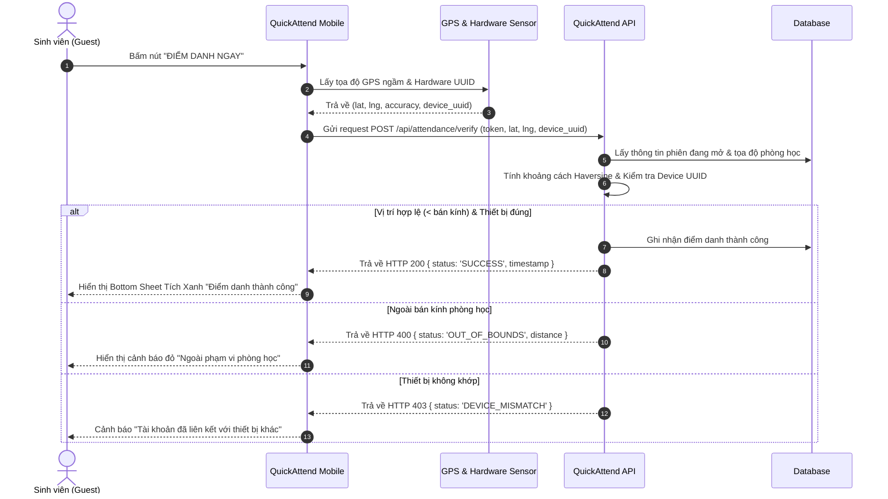

# Kiến trúc kỹ thuật hệ thống QuickAttend (System Architecture)

## 1. Tổng quan kiến trúc
QuickAttend được thiết kế theo kiến trúc hướng dịch vụ (Service-Oriented Architecture), kết hợp giữa ứng dụng di động đa nền tảng (React Native / Expo) và hệ thống Backend RESTful API với cơ chế xác thực vị trí thời gian thực (Geofencing Engine).

---

## 2. Các tầng thành phần (Layered Architecture)

### 2.1. Tầng Giao diện & Thiết bị (Mobile Client)
- **Framework:** React Native + Expo SDK 52 với Expo Router.
- **Quản lý trạng thái (State Management):** Zustand / React Context cho lightweight reactivity.
- **Dịch vụ định vị (Location Services):** Sử dụng `expo-location` với độ chính xác cao (`Accuracy.High`) để đo tọa độ GPS (Latitude, Longitude) và tính toán khoảng cách so với tọa độ phòng học theo công thức Haversine.
- **Bảo mật phần cứng (Hardware Security):**
  - Khóa mã nhận dạng thiết bị (`Device UUID`) ngăn đăng nhập chéo.
  - Tích hợp `expo-local-authentication` hỗ trợ Face ID / Fingerprint cục bộ khi có cảnh báo bất thường.
- **Offline & Fallback Mechanism:**
  - Hàng đợi offline (`Offline Queue`) lưu trữ kết quả điểm danh vào SQLite / AsyncStorage khi phòng học rớt mạng 4G/Wi-Fi.
  - Tự động kích hoạt đồng bộ khi có kết nối trở lại.

### 2.2. Tầng Máy chủ (Backend API & Business Logic)
- **Runtime:** Node.js (TypeScript) với Express hoặc Fastify.
- **Authentication Service:**
  - Kiểm tra tên miền email trường hợp lệ (`@hcmut.edu.vn`, `@*.edu.vn`).
  - Cấp phát JWT token kèm phân quyền `ROLE_HOST` (Giảng viên) và `ROLE_GUEST` (Sinh viên).
- **Session & Handover Engine:**
  - Quản lý vòng đời phiên điểm danh (Active, Closed, Expired).
  - Quản lý mã phiên (Session Code) và cơ chế ủy quyền tạm thời (Temporary Delegation Token) có thời hạn cho giảng viên dạy thay.
- **Geofencing & Fraud Detection:**
  - Tính toán khoảng cách tọa độ sinh viên so với phòng học.
  - So khớp mã phần cứng thiết bị nhằm phát hiện hành vi mượn máy điểm danh hộ.
  - Kiểm tra bất thường di chuyển (Impossible Travel Velocity).

### 2.3. Tầng Dữ liệu (Persistence Layer)
- **Cơ sở dữ liệu chính:** PostgreSQL (hoặc Supabase PostgreSQL).
- **Các bảng chính:**
  - `users`: Thông tin người dùng, vai trò (Host/Guest), email trường.
  - `devices`: Bản đồ định danh phần cứng (user_id, device_uuid, device_model).
  - `attendance_templates`: Mẫu ca học đã lưu (tên môn, phòng, lat, lng, radius_meters).
  - `sessions`: Phiên điểm danh đang mở hoặc đã kết thúc, người sở hữu gốc và người được ủy quyền tạm thời.
  - `attendance_records`: Kết quả điểm danh (session_id, student_id, is_inside_geofence, verified_at, status).
  - `delegations`: Lịch sử bàn giao quyền tạm thời giữa các giảng viên.

---

## 3. Biểu đồ luồng dữ liệu (Data Flow)

### 3.1. Luồng Điểm danh 1 chạm của Sinh viên (Guest Flow)

